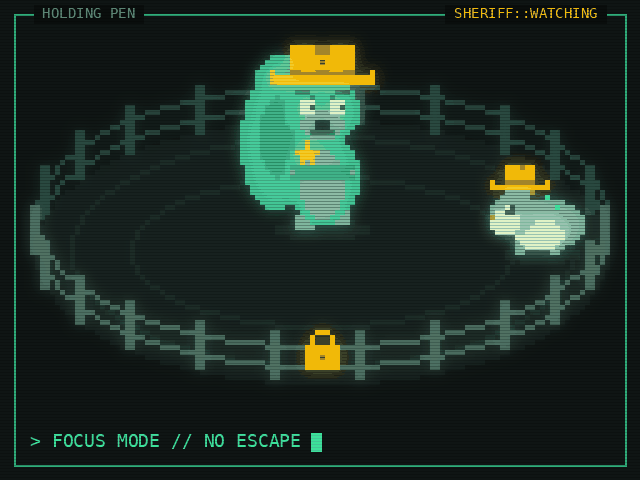

<p align="center">
  
</p>

<p align="center"><strong>A todo app that ensures law and order in the delivery of your work.</strong></p>

<p align="center">
  
</p>

---

SHERIFF doesn't just list your todos — it makes you serve them. Create time-boxed lists with a
task limit, give every task a duration, and run focus sessions that automatically split that
duration into **25-minute focus rounds with 5-minute breaks** until the time is served.

## Features

- **Lists with terms** — name, brief, start/end dates and a task limit. Status tags show
  `ACTIVE`, `UPCOMING`, `OVERDUE` or `CLEARED`, plus a live deadline countdown.
- **Tasks with durations** — title, notes, priority and a duration (with presets). A live
  _focus plan_ preview shows exactly how the time will be split.
- **Task limits enforced** — once a list is full, adding is locked until you raise the limit or
  clear a task.
- **Focus sessions** — full-screen timer, phase timeline, pause/resume, skip, minimise to the
  status bar, and resume after reloads. Served minutes are logged against the task; the session
  ends when the duration is exhausted.
- **Safe deletes** — removing a task or a list is confirmed in a modal; deleting a list warns
  that every task in it goes too.
- **Drag to reorder** tasks (mouse, touch or keyboard).
- **Command palette** (`Ctrl/⌘ K`) and keyboard shortcuts (`?` for the list).
- **Synthesised sound cues** via the Web Audio API, with a mute toggle.
- **Themes**: phosphor (default), amber, cyberpunk, and _clean_ (no glow/scanlines).
- **Offline by design** — everything is saved to `localStorage`.

## Quick start

```bash
npm install
npm run dev        # http://127.0.0.1:5317
```

## Scripts

| Script                  | What it does                                   |
| ----------------------- | ---------------------------------------------- |
| `npm run dev`           | Vite dev server                                |
| `npm run build`         | Typecheck + production build to `dist/`        |
| `npm run preview`       | Serve the production build                     |
| `npm test`              | Jest unit & integration tests                  |
| `npm run test:coverage` | Jest with coverage                             |
| `npm run e2e`           | Start the dev server and run Cypress headless  |
| `npm run cy:open`       | Cypress interactive runner (start `dev` first) |
| `npm run lint`          | ESLint                                         |
| `npm run typecheck`     | TypeScript for app + Cypress                   |
| `npm run check`         | typecheck + lint + unit tests                  |

## Tech stack

TypeScript · React 19 · Vite · Plain CSS (design tokens) · Lucide icons · Radix UI · Zustand ·
dnd-kit · tinykeys · cmdk · Web Audio API · Jest + Testing Library · Cypress

## How focus sessions are planned

The task's **remaining** duration is split into 25-minute focus phases with a 5-minute break
between each; the last phase takes whatever is left and no break follows it.

| Duration | Plan                                 | On the clock |
| -------- | ------------------------------------ | ------------ |
| 20 min   | F20                                  | 20 min       |
| 50 min   | F25 · B5 · F25                       | 55 min       |
| 60 min   | F25 · B5 · F25 · B5 · F10            | 70 min       |
| 100 min  | F25 · B5 · F25 · B5 · F25 · B5 · F25 | 115 min      |

The logic lives in [`src/lib/focus.ts`](src/lib/focus.ts) as pure, fully tested functions.

## Project structure

```
src/
  lib/        pure logic: focus planner + timer, validation, dates, sound
  store/      Zustand stores (domain data, focus session, UI)
  features/   lists, tasks, focus session, command palette
  components/ shared UI primitives, status bar, dialogs, toasts
  styles/     design tokens + plain CSS
cypress/      end-to-end tests
```
